# Getting started with WattNot

WattNot checks how much power, money and water each AI answer costs, cuts the waste, and gives you
a signed receipt you can check. This guide takes you from a fresh laptop to a running dashboard,
then to live runs on your own keys or GPU. It works on macOS, Linux and Windows. **Docker is not needed.**

> **Judging? Fastest path.** Run `./start.sh` (Mac/Linux) or `start.cmd` (Windows). No keys, no GPU,
> no money. It checks your machine, installs into `.venv`, runs a smoke test and opens the dashboard
> on our recorded H100 run (REPLAY of MEASURED numbers). About 2 minutes the first time.

Every number WattNot shows carries a label: MEASURED, ESTIMATE, SIMULATED or REPLAY.

## 1. Get the code

```bash
git clone https://github.com/ak9381/wattnot.git
cd wattnot
```

Windows: same commands in PowerShell (needs Git; step 3 can install it for you with winget).

## 2. One command

| You are on | Run |
|---|---|
| macOS (Apple Silicon or Intel), Linux | `./start.sh` or `make start` |
| Windows 10/11 | `start.cmd` (or `powershell -ExecutionPolicy Bypass -File start.ps1`) |

It runs five steps in order. Each is shown below with real output from our test runs.

### Step 1: Preflight

Checks Python 3.11+, pip/venv, git, curl, 2 GB free disk, a free dashboard port (8765 by default)
and that pypi.org is reachable. It prints a table and changes nothing.

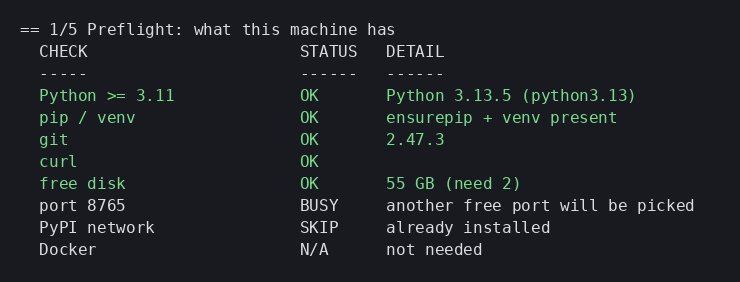

### Step 2: Install

If something is missing, it asks once (`y/N`) before any system install:

- **macOS:** `brew install python@3.12 git`. No Homebrew? It prints the one-line Homebrew install and stops.
- **Linux:** prints the exact `apt-get` or `dnf` command for you to run with sudo, then stops.
- **Windows:** `winget install Python.Python.3.12 Git.Git` (Python installs per-user, no admin). Open a new window afterwards so PATH updates.

Then it makes `.venv` and installs WattNot from the pinned `requirements-lock.txt`.
Set `WATTNOT_YES=1` to answer yes automatically (CI).

### Step 3: Compatibility check

OS and version, CPU arch (arm64 or x86_64), Python version, `import wattnot`, a smoke test with no
GPU and no keys, and an info-only NVIDIA GPU check. You should see `SMOKE PASS`.

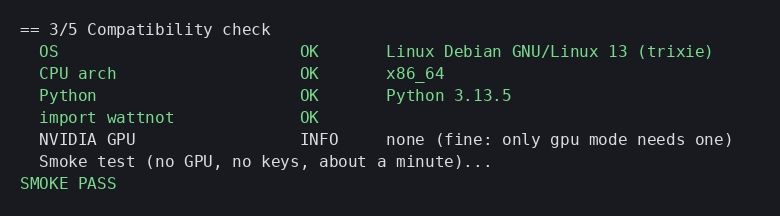

`./start.sh check` (or `start.cmd check`, `make start-check`) stops here and leaves nothing running.

### Steps 4 and 5: Start and open

It starts the dashboard on the recorded H100 run, waits for `/api/dash/health`, then opens your browser.
If 8765 is busy, a free port is picked. Press Ctrl+C to stop.

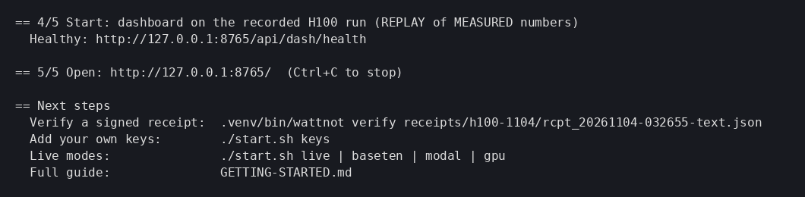


## 3. Keys (only for live modes)

```bash
./start.sh keys        # Windows: start.cmd keys
```

It asks for each key with hidden input (press Enter to skip), writes them to `.env` (gitignored,
mode 600 or owner-only on Windows) and shows only `set` / `not set`. Values are never printed.

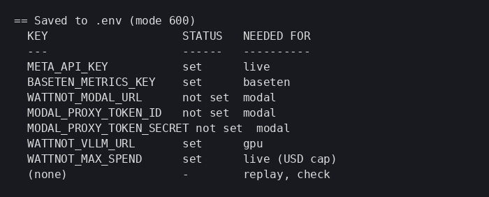

| Key | Needed for |
|---|---|
| (none) | `replay`, `check` |
| `META_API_KEY` | `live` |
| `WATTNOT_MAX_SPEND` | spend cap in USD for live calls (default 0.50) |
| `BASETEN_METRICS_KEY` | `baseten` |
| `WATTNOT_MODAL_URL`, `MODAL_PROXY_TOKEN_ID`, `MODAL_PROXY_TOKEN_SECRET` | `modal` |
| `WATTNOT_VLLM_URL` | `gpu` |

**Cost note:** live modes use your own keys and bill your own accounts. WattNot checks
`WATTNOT_MAX_SPEND` before each paid call and stops when the cap is reached.

## 4. Modes

Each is one command. Windows: replace `./start.sh` with `start.cmd`.

### replay (default)
`./start.sh` or `./start.sh replay`. No keys, no GPU. Dashboard on our recorded H100 80GB run; the
numbers are MEASURED on that run and shown as REPLAY.

**Pick any recorded run in the dashboard.** When no live run is active, the first screen is
**Replay a run**. It lists every run under `replays/` on your disk (name, platform, date, what it
was, its label). Click one and it plays back on a live power graph, with a
`REPLAY of MEASURED run <id>` banner, Pause/Play, Restart, and Real speed or 4x. Playback keeps the
real gaps between recorded events but shortens idle stretches over 3 s; the page says how much was
cut. Baseten is a hosted API with no GPU power meter, so its runs show steps but no power line.
You can also open one directly: `http://127.0.0.1:<port>/?replay=modal-r1`.

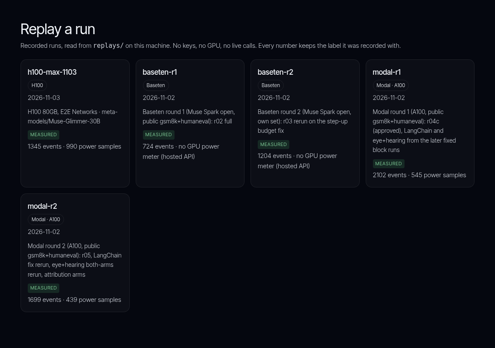

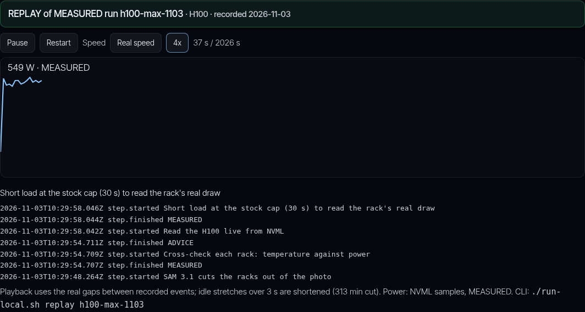

**Or from the terminal:** `./run-local.sh replay <id>` with `h100-max-1103`, `modal-r1`,
`modal-r2`, `baseten-r1` or `baseten-r2`. That starts a separate dashboard on that run.

### live: token savers on Meta models
Needs `META_API_KEY`. Runs routing, thinking budget, context saver and the agent-waste proxy against
the Meta API, capped by `WATTNOT_MAX_SPEND`. No GPU. Results go to `out/`.
Without a key it stops cleanly:

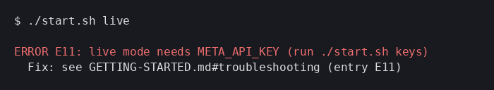

### baseten: reasoning-effort tuning on a hosted model
Needs `BASETEN_METRICS_KEY` (your Baseten workspace key). Runs `wattnot cloud tune --live` on the
model WattNot was tested with (`meta-models/muse-spark-open` at `inference.baseten.co`, fixed in
code). It finds the cheapest reasoning effort that keeps answers right and writes a receipt.
We tested this live on our own workspace; recorded runs are `baseten-r1` and `baseten-r2`
(`./run-local.sh replay baseten-r1`). `BASETEN_API_KEY` is refused on purpose.

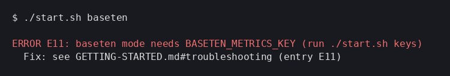

### modal: the same tuning on your Modal endpoint
Needs `WATTNOT_MODAL_URL` (or `MODAL_ENDPOINT_URL`) plus `MODAL_PROXY_TOKEN_ID` and
`MODAL_PROXY_TOKEN_SECRET`. Runs `wattnot cloud tune --provider modal --live`. We tested it on our
own Modal app (recorded as `modal-r1`, `modal-r2`); deploying your own app is in `docs/MODAL-FULL-STAGE.md`.

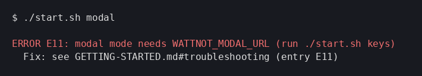

### gpu: power caps on your own NVIDIA GPU
Needs Linux, an NVIDIA GPU with `nvidia-smi`, a vLLM server at `WATTNOT_VLLM_URL`, and root to set
power limits. It runs the doctor first, then caps at `WATTNOT_CAP_W` and gates on answer quality,
restoring the stock limit on exit (`WATTNOT_RESTORE_CAP=1`).

Limitations, plainly:
- Validated on **H100 80GB only**. Other GPUs are untested; caps there are refused unless you set `WATTNOT_ALLOW_UNTESTED_GPU=1`.
- Caps clamp to the range your card allows (`nvidia-smi -q -d POWER`).
- Needs permission to run `nvidia-smi -pl` (root or an admin-granted rule).
- Board power read from NVML is MEASURED. Per-answer joules split from it are MEASURED totals divided by answers; carbon and water use published grid factors, so they are ESTIMATE.
- Windows: power caps are not supported; `start.cmd gpu` explains this and stops.

On a machine without a GPU it explains and stops:

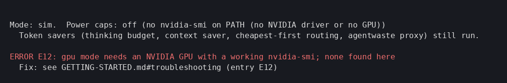

## 5. Verify a receipt

```bash
.venv/bin/wattnot verify receipts/h100-1104/rcpt_20261104-000651-text.json
# Windows: .venv\Scripts\wattnot.exe verify receipts\h100-1104\rcpt_20261104-000651-text.json
```

It checks the hash, signature, Rekor transparency-log entry and that the joules, carbon and water
add up. Every line should say `ok`.

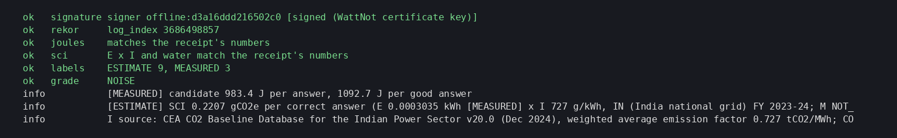

## Troubleshooting

Script errors print `ERROR Exx` and point here.

| Code / symptom | Cause | Fix |
|---|---|---|
| **E00** unknown command | Typo in the mode | Use `replay`, `check`, `keys`, `live`, `baseten`, `modal` or `gpu`. |
| **E01** missing python/git, install declined or failed | Python 3.11+ or git not installed | Mac: `brew install python@3.12 git`. Linux: `sudo apt-get install -y python3.12 python3.12-venv git curl` (or `dnf`). Windows: `winget install Python.Python.3.12 Git.Git`. Then re-run. |
| **E02** Homebrew is missing | Fresh Mac | Run the printed Homebrew one-liner, open a new terminal, re-run `./start.sh`. |
| **E03** winget is missing | Older Windows 10 | Install "App Installer" from the Microsoft Store, or Python from python.org (tick "Add python.exe to PATH"). |
| **E05** low disk | Under 2 GB free | Free some space, re-run. |
| **E06** cannot reach pypi.org | Offline, proxy or SSL inspection | Set `HTTPS_PROXY=http://proxy:port`; for corporate SSL set `PIP_CERT=/path/to/ca.pem`. Check with `curl https://pypi.org/simple/pip/`. |
| **E07** pip install failed | Network, SSL, or a wheel missing for your platform | Read `/tmp/wattnot-setup.log`. Delete `.venv` and re-run. On Intel Macs use Python 3.12 from brew. |
| **E08** import wattnot failed | Broken `.venv` | `rm -rf .venv` (Windows: `rmdir /s .venv`), re-run. |
| **E09** smoke test failed | Install incomplete or a real bug | See `/tmp/wattnot-smoke.log`; re-run after deleting `.venv`; open an issue with the log. |
| **E10** dashboard did not start / health timed out | Port clash or crash | See `/tmp/wattnot-dash.log`. Try `WATTNOT_PORT=8799 ./start.sh`. |
| **E11** mode needs KEY | Key not in `.env` or shell | `./start.sh keys`, then re-run the mode. |
| **E12** no NVIDIA GPU | No GPU or no driver | Use `replay`, `live`, `baseten` or `modal`. On a GPU box install the NVIDIA driver so `nvidia-smi -L` works. |
| **E13** vLLM not reachable | Server down or wrong URL | Start vLLM; `curl $WATTNOT_VLLM_URL` minus `/chat/completions` plus `/models` should answer. |
| **E14** gpu on Windows | Power caps need Linux + root | Run `./start.sh gpu` on a Linux GPU host. |
| Python too old (3.9/3.10) | System Python | Install 3.12 as in E01; the scripts pick the newest 3.11+ automatically. |
| Port in use | Something on 8765 | A free port is picked for you; or set `WATTNOT_PORT`. |
| `start.ps1 cannot be loaded ... execution policy` | Windows blocks scripts | Use `start.cmd`, or `Set-ExecutionPolicy -Scope Process Bypass` in that window. |
| Apple Silicon vs Intel | x86_64 shell under Rosetta on an M-series Mac | Preflight warns; open a normal (arm64) terminal and use arm64 Homebrew in `/opt/homebrew`. Both work. |
| 401 from Meta or Baseten | Wrong or expired key | Re-enter it with `./start.sh keys`. For Baseten use `BASETEN_METRICS_KEY`, not `BASETEN_API_KEY`. |
| Spend cap hit | `WATTNOT_MAX_SPEND` reached | Expected stop. Raise it in `.env` only if you mean to spend more. |
| `nvidia-smi -pl`: insufficient permissions | Not root | Run gpu mode with sudo, or have an admin allow `nvidia-smi -pl`. |

Still stuck? `./run-local.sh doctor` checks your machine and changes nothing.
