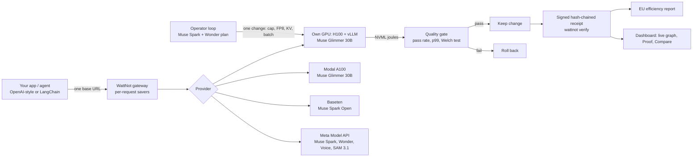
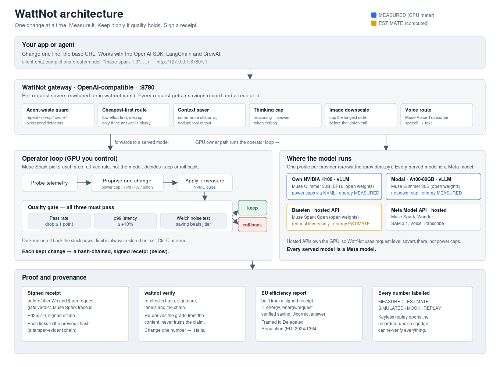

# WattNot

**WattNot cuts the energy of every LLM request and refuses any change that makes answers worse.**

It is an agent that tries one serving change at a time (GPU power cap, FP8, KV cache, batching,
prefix caching, reasoning effort), measures the joules on the GPU, and keeps the change only if a
fixed quality gate passes. Every kept change becomes a signed, hash-chained receipt you can
re-verify. Built on Meta models.

**Built with Muse Spark Open**, a Meta open-weight model (it runs the hosted-API saver round on
Baseten, alongside open-weight Muse Glimmer 30B as the served model being tuned).

**Demo video (3 min): VIDEO_LINK_TBD**

---

## Install and run

You need **Python 3.11+** and **git**. No GPU, no keys, no money spent for the default run.

```bash
git clone https://github.com/ak9381/wattnot.git && cd wattnot
./start.sh                      # macOS / Linux / WSL   (Windows: start.cmd)
```

`./start.sh` runs a preflight, makes a `.venv` from the pinned `requirements-lock.txt`, runs a
smoke test, then starts the dashboard and opens your browser. It opens on the **Plugin H100**
recorded run by default (`web/dash/runset.js:12`, `DEFAULT_RUN = "plugin-h100-1104"`) — a real
Nov 4 run replayed on your machine, no GPU or network call.

**Want live calls? Add your key (30 seconds):**

1. Copy `.env.example` to `.env` (`cp .env.example .env`; PowerShell: `Copy-Item .env.example .env`).
2. Paste your Meta API key into `META_API_KEY`. Modal and Baseten keys are optional.
3. Never commit `.env`. It is already gitignored.
4. No key? Just run `./start.sh`. It plays the keyless recorded replay.

A one-line `curl … | bash` installer (`start-here/install.sh`) is **coming**; it is not in the
repo yet. For now use the `git clone` + `./start.sh` path above.

**Docker is not required.** If you prefer a container, `Dockerfile` builds a replay-only image
(the dashboard on a saved run) and `Dockerfile.agent` builds the GPU agent image. Neither is
needed for the default run.

### Modes

| Command | What runs | Needs |
|---|---|---|
| `./start.sh` / `replay` | Dashboard on the recorded H100 run (REPLAY of MEASURED numbers) | nothing |
| `./start.sh check` | Preflight, install and compatibility check only | nothing |
| `./start.sh keys` | Enter API keys (hidden input) into `.env` (mode 600); shows set / not set only | |
| `./start.sh live` | Token savers on live Meta models | `META_API_KEY` |
| `./start.sh baseten` | Reasoning-effort tuning on Baseten | `BASETEN_METRICS_KEY` |
| `./start.sh modal` | Reasoning-effort tuning on your Modal endpoint | `WATTNOT_MODAL_URL`, `MODAL_PROXY_TOKEN_ID/SECRET` |
| `./start.sh gpu` | Power caps on your own NVIDIA GPU + vLLM (Linux, root) | `WATTNOT_VLLM_URL` |

### Keys

The default run needs no keys. Live modes are **bring-your-own-key**.

**Judge setup, in order:**

1. `cp .env.example .env` (PowerShell: `Copy-Item .env.example .env`).
2. Set `META_API_KEY` to your own Meta Model API key. This is the only key the live token savers
   need; the Modal and Baseten values below are optional.
3. Optional — Modal: your own endpoint and proxy tokens (`WATTNOT_MODAL_URL`,
   `MODAL_PROXY_TOKEN_ID`, `MODAL_PROXY_TOKEN_SECRET`). Optional — Baseten: `BASETEN_METRICS_KEY`.
4. `./start.sh keys` enters any key with hidden input instead of editing the file by hand; it writes
   `.env` (gitignored, mode 600) and prints set / not set only, never the value.

Keys are written to `.env` (gitignored, mode 600) and never printed.

- **Meta Model API** — your own key in `META_API_KEY`. Needed for live Muse Spark, Wonder, SAM
  3.1 and Voice Transcribe, and for the token savers.
- **Baseten** — bring-your-own-key only (`BASETEN_METRICS_KEY`), for Muse Spark Open.
- **Modal** — your own endpoint and proxy tokens (`WATTNOT_MODAL_URL`, `MODAL_PROXY_TOKEN_ID`,
  `MODAL_PROXY_TOKEN_SECRET`).

A shared demo key for Meta API and Modal, served behind a **capped server-side proxy** so judges
can try live calls without their own account, is **coming** (not built; there is no proxy or
shared key in the repo). Today every live path uses your own key.

### Common environment variables

The full list, names only, is in [`.env.example`](.env.example). Copy it and fill in what you have:

```bash
cp .env.example .env            # macOS / Linux / WSL   (PowerShell: Copy-Item .env.example .env)
```

| Variable | What it is | Needed for |
|---|---|---|
| `META_API_KEY` | Your Meta Model API key | `live`, SAM, voice |
| `META_BASE_URL` | Override the Meta API base URL | optional |
| `WATTNOT_VLLM_URL` | Your vLLM chat endpoint on the GPU box | `gpu` |
| `WATTNOT_MODEL_CONFIG` | `muse-glimmer-30b` or `muse-glimmer-30b-fp8` | `gpu` |
| `WATTNOT_CAP_W` | Power cap in watts to test against stock | `gpu` |
| `WATTNOT_RESTORE_CAP` | `1` = restore the stock power limit on exit (keep it on) | `gpu` |
| `WATTNOT_ALLOW_UNTESTED_GPU` | `1` = allow caps on a GPU we have not tested | `gpu` |
| `WATTNOT_MAX_SPEND` | USD ceiling for live Meta API steps (default `0.50`) | `live` |
| `WATTNOT_PORT` | Dashboard port (a free one is picked if busy) | optional |
| `BASETEN_METRICS_KEY` | Your Baseten workspace key | `baseten` |
| `WATTNOT_MODAL_URL` | Your Modal endpoint URL | `modal` |

Full walkthrough and troubleshooting: [GETTING-STARTED.md](GETTING-STARTED.md).

---

## Eligibility and disclosures

**Built entirely during the hackathon, Oct 26 – Nov 4, 2026.** The repo was created on 2026-10-26.
The first commit is `043ce2c`, 2026-10-26 22:09 IST ("Planning docs, README and license") — after the
Oct 26 kickoff ended at 12:24 PM ET (9:54 PM IST). The git history holds every step since. Nothing pre-existing is vendored: the only third-party code in the
tree is fonts and icons under `web/dash/vendor/`; all other dependencies are installed from PyPI by
`./start.sh` and listed below. No code existed before the hackathon started.

- **Track:** Indie (solo). **Problem statement:** Push the Frontier (energy).
- **Bonus categories:** Best Build on Meta Open Weight Models, Best Agentic Use-Case.

### Hackathon rules checklist

✅ = met and checked. ⏳ = pending, not done yet.

| Rule | Status | How we meet it | Evidence |
|---|---|---|---|
| New work only | ✅ | Repo created Oct 26; first commit `043ce2c` at 22:09 IST, after kickoff ended at 12:24 PM ET (9:54 PM IST). | `git log --reverse`, [Eligibility](#eligibility-and-disclosures) |
| Public repo, open licence | ✅ | Public on GitHub, MIT licence. | [`LICENSE`](LICENSE) |
| Only Meta models at runtime | ✅ | Every runtime model is a Meta model; the table says where each runs. No Llama model is used. Some old Llama names in UI text and runbooks are being removed on `fix/no-llama-1105` (⏳ merge). | [Meta models used](#meta-models-used-and-where-each-runs) |
| Open weights | ✅ | Open-weight Meta models we run: **Muse Glimmer 30B** (vLLM BF16 on our rented H100 80GB, and on Modal A100-80GB) and **Muse Spark Open** (Baseten, hosted). Why: WattNot tunes power caps, batching, KV cache and FP8, which only works on a server we control. Licences: each under Meta's own model licence for that release (see the model cards). SAM 3.1 is called through the hosted Meta Model API here, not self-hosted, and the Open Weight bonus counts only Glimmer and Spark Open, not SAM. | [Open weights: how, where, why](#open-weights-how-where-why) |
| TTS disclosed | ✅ | Video voice-over is Runway TTS (ElevenLabs `eleven_v4`). Piper only pre-voices test clips offline, not in the runtime path. | [TTS disclosure](#demo-video-and-voice-tts-disclosure) |
| Muse Image disclosed | ✅ | Vision gate and SAM hotspot images were pre-generated with Muse Image and labelled SYNTHETIC. No live call. | [Datasets](#public-datasets-and-our-own-sets) |
| Built with Muse Spark Open | ✅ | Stated at the top of this README. App footer line is on `fix/footer-spark-open-1105` (⏳ merge). | top of README |
| Data rights | ✅ | Public sets are MIT / CC BY / CC BY-SA with attribution; our own sets are CC0. Only data we have rights to. | [`DATASET-LICENCES.md`](DATASET-LICENCES.md) |
| Judges can run it | ✅ | `./start.sh` plays a keyless recorded replay. Live modes use your own key via `.env.example`; `.env` is gitignored. An old rehearsal key in early history (`856c06f`) is revoked. | [Keys](#keys), [`.env.example`](.env.example) |
| Demo video | ⏳ | Plan: ≤ 3:00, mostly real screen footage, AI avatar and TTS labelled, replays labelled REPLAY, opens with a built-this-week line. Link not added yet. | Demo video link above (TBD) |
| Not a banned category | ✅ | An energy and serving-efficiency agent for LLM inference. Not health, RAG, education, hiring, nutrition, sports, personality or political. | [What it does](#what-it-does-and-why) |
| Team, track, problem | ✅ | Solo (Akash K Raju), Indie track, Push the Frontier (energy). | [Team and licence](#team-and-licence) |

### Meta models used, and where each runs

Every model WattNot runs is a Meta model. In a live run each call below has a trace id, latency and
`$` in the run's event log.

| Model | Where it runs | What it does | File path |
|---|---|---|---|
| **Muse Spark** (`muse-spark-1.3`) | Meta Model API, hosted | Operator: picks the next change, grades answers for the quality gate, explains a verdict (the fixed rule still decides). Also the context-saver summariser and the voice-guide intent step | `src/wattnot/meta/`, `src/wattnot/context_saver/middleware.py` |
| **Muse Spark Open** (`meta-models/muse-spark-open-1026`, open weights) | Baseten, hosted | The hosted-API round: effort routing with step-up, LangChain saver; also a planner arm for the cap sweep | `src/wattnot/spark_open/` |
| **Muse Glimmer 30B** (`meta-models/Muse-Glimmer-30B`, open weights) | Our rented NVIDIA H100 (vLLM, BF16) and Modal A100-80GB | The served model being tuned. Every power cap, thinking budget, saver and agent-waste arm is measured on its answers; it also reads the vision test images | `scripts/glimmer_serve.sh`, `src/wattnot/longrun/`, `src/wattnot/vision/client.py` |
| **Muse Wonder** (`muse-wonder-1.0`) | Meta Model API, hosted | Plans which cap and clock to try next, and reads the Pareto (Wonder) chart | `src/wattnot/meta/wonder.py`, `src/wattnot/wonderchart/` |
| **Muse Voice Transcribe** (`muse-voice-transcribe-1.0`) | Meta Model API, hosted | Spoken Ask (speech to text), and the dashboard mic (reads a card back, or fills a run form) | `src/wattnot/spokenanswer/client.py`, `src/wattnot/meta/voiceguide.py` |
| **SAM 3.1** (`sam-3.1`) | Meta Model API, hosted | Rack hotspot audit: segments a room scan into units (a cross-check, kept off the main path) | `src/wattnot/sam/client.py` |
| **Muse Code** | Hosted | Opened the power-cap tuning PR from a run result (replayed in demos; no PR is opened live) | `src/wattnot/musecode/` |

**Every runtime model is a Meta model; no Llama model is used.** Synthetic test images for the
vision quality gate and the SAM hotspot set were pre-generated with **Muse Image** ahead of time and
labelled SYNTHETIC; no run makes a live Muse Image call, so it is not a runtime model.

### Open weights: how, where, why

**Why.** WattNot saves energy by changing how the model is served: GPU power caps, batch size,
KV-cache settings and quantization. None of that can be changed behind a closed API. WattNot needs a
model whose server it controls, so it can change one setting at a time and read the joules on the GPU.

- **Muse Glimmer 30B on our rented H100 80GB** (bare VM, root). Served with vLLM in BF16
  (`bash scripts/glimmer_serve.sh bf16`, `--reasoning-parser muse_glimmer`). This is the model whose
  answers WattNot measures and grades against the stock run.
- **Muse Glimmer 30B on Modal A100-80GB.** The same vLLM setup on Modal's hosted GPU. Energy is still
  read from NVML (MEASURED); power caps are off because Modal refuses the NVML write.
- **Muse Spark Open on Baseten** (`meta-models/muse-spark-open-1026`). A hosted API, so WattNot uses
  request-level savers only: effort routing with step-up and the LangChain saver. Energy here is an
  ESTIMATE (tokens → joules), because there is no GPU meter.
- **FP8 tried and refused by the quality gate.** On the H100 (Nov 4, one-lever test) FP8 cut energy
  **42.5%** but matched only **15 of 16** answers, so WattNot refused it and rolled back to BF16
  (MEASURED). KV cache saved 1.4% but made p99 43.6% worse, also refused (MEASURED). Proof:
  [`replays/h100-max-1103/`](replays/h100-max-1103/manifest.json).

**What it cost us** (open-weights runs):

| Where | Model | Cost | Label |
|---|---|---|---|
| Our rented H100 (E2E Networks) | Glimmer 30B | GPU hours at ₹451.2/h; one retest ≈ ₹1,571 ([`docs/RUN_HISTORY.md`](docs/RUN_HISTORY.md) #1) | ESTIMATE |
| Modal A100-80GB | Glimmer 30B | per round: $4.87 (r04c), $4.42 (r04f) | MEASURED |
| Modal A100-80GB | Glimmer 30B | r05: $3.47 (wall minutes × list price, [`receipt`](replays/modal-r2/receipt.json)) | ESTIMATE |
| Baseten | Muse Spark Open | per round: $0.54 + $0.21 Meta (r02); $0.88 + $0.16 Meta (r03) | MEASURED |

The Meta Model API ledger read **$30.46** total by 2 Nov (MEASURED, API ledger), under the
self-imposed $120 cap.

### Public datasets and our own sets

Full licence detail, links and attribution: [`DATASET-LICENCES.md`](DATASET-LICENCES.md).

| Set | Source | Licence | Note |
|---|---|---|---|
| GSM8K (first 60 / 300 / full 1319, and the 977-item sealed holdout) | [openai/grade-school-math](https://github.com/openai/grade-school-math) | MIT | evaluation data; licence in `data/public_bench/` |
| HumanEval (first 40 / full 164) | [openai/human-eval](https://github.com/openai/human-eval) | MIT | evaluation data; licence in `data/public_bench/` |
| proof-v1, tiers-v1, cloud-effort-v1, prefix-cache-v1, judge-30 | Made by us | CC0 (GSM8K parts keep MIT) | SYNTHETIC |
| Vision eye / SAM hotspot images | Pre-generated with Muse Image | CC0 (our outputs under Meta API terms) | SYNTHETIC, no live call |
| Spoken test clips (20 WAV) | Our text, voiced offline with Piper (LJ Speech voice) | CC0 | SYNTHETIC; transcription is live Muse Voice |
| Rack photos (Cisco, HPE, Compaq, ARSAT …) | Wikimedia Commons | CC BY 2.0 / CC BY-SA 4.0 | attributed; derived SAM masks share-alike |

### Third-party services and libraries

| Component | Used for | Licence |
|---|---|---|
| Baseten | Hosted Muse Spark Open API (BYOK) | service |
| Modal | Hosted A100 for Glimmer (BYOK) | service |
| E2E Networks | Rented H100 80GB VM | service |
| vLLM | Serving Muse Glimmer 30B | Apache 2.0 |
| NVIDIA NVML (via ctypes) | Power readings and power caps | NVIDIA driver licence |
| LangChain (`langchain-core`, `langchain-openai`) | Agent-framework drop-in tests | MIT |
| FastAPI, Uvicorn | Dashboard server | MIT, BSD-3 |
| Optuna | Picking the next cap to try | MIT |
| jsonschema, cryptography | Schema checks, Ed25519 signing | MIT, Apache 2.0 / BSD |
| OpenAI Python SDK | Client for OpenAI-compatible endpoints (vLLM, Meta API) | Apache 2.0 |
| NumPy, Pillow | Image maths, overlays and charts | BSD-3, MIT-CMU |
| Piper | Made the spoken test clips offline (not in the runtime path) | MIT |
| sigstore-python (optional) | Publishing receipts to the public Rekor log | Apache 2.0 |
| Inter, JetBrains Mono, Lucide | Fonts and icons in `web/dash/vendor/` | OFL 1.1, OFL 1.1, ISC |

### Demo video and voice (TTS) disclosure

- **Demo video voice-over** is AI text-to-speech, made with Runway TTS (ElevenLabs `eleven_v4`). The
  words are ours; only the narration voice is synthetic.
- **Presenter avatar** in the video is AI-generated, and is labelled as such on screen.
- **The app's offline voice** is Piper TTS (open, offline). WattNot uses it to voice the spoken test
  clips ahead of time; it runs offline and is **not in the judged runtime path**. The dashboard's own
  read-back uses the browser's speech synthesis, not Piper. (See the datasets table above and
  [`DATASET-LICENCES.md`](DATASET-LICENCES.md).)
- **TTS is only ever used for voice output** (narration and spoken test clips). Nothing WattNot
  measures, grades or decides depends on it; speech going the other way (spoken questions in) is
  transcribed live by Meta's Muse Voice Transcribe.

---

## What it does, and why

Data-center electricity is on track to roughly double by 2030 (IEA: 415 TWh in 2024, ~945 TWh by
2030). Most of that is served inference. Token trimmers cut your bill, but not your watts: they send
fewer tokens, they do not change how many joules each token burns on the GPU.

WattNot measures the joules. It plugs in as an OpenAI-compatible gateway in front of your app, and on
a GPU you own it runs an operator loop that tries one serving change at a time. It keeps a change only
if three fixed checks pass:

1. **Pass rate** on a fixed prompt set drops by no more than 1 point (default).
2. **p99 latency** stays within +10% (default).
3. A **Welch noise test** confirms the saving beats run-to-run jitter.

The model can explain a verdict; it never overrides it. The rule decides. Each kept change becomes a
hash-chained receipt, signed offline (Ed25519), with before/after Wh and `$` per request, and
`wattnot verify` re-checks it. Change one number and verification fails.

---

## Results

Every number is labelled and linked to the file it comes from. **MEASURED** = read from the GPU
meter (NVML) or the billing ledger. **ESTIMATE** = computed (for example tokens → joules). The
detailed method is in [`docs/joules-per-correct-answer.md`](docs/joules-per-correct-answer.md).

**Headline — Plugin run, H100 (Nov 4, MEASURED).** Live traffic through the WattNot gateway, Muse
Glimmer 30B (BF16, vLLM) on a rented NVIDIA H100 80GB, 375 W cap vs stock 700 W:
**−12.9% joules per correct answer** (1249.4 → 1088.5 J/correct), with quality held at **54/60** in
both arms (Welch p = 0.027). Proof:
[`receipts/h100-1104/rcpt_20261104-000651-text.json`](receipts/h100-1104/rcpt_20261104-000651-text.json),
[`replays/plugin-h100-1104/manifest.json`](replays/plugin-h100-1104/manifest.json).

| Run | Where | Result | Quality | Label | Proof |
|---|---|---|---|---|---|
| Plugin run, text (Nov 4) | H100 80GB, 375 W | −12.9% J/correct (1249.4 → 1088.5) | 54/60 → 54/60 | MEASURED | [receipt](receipts/h100-1104/rcpt_20261104-000651-text.json) |
| Sealed GSM8K holdout (Nov 3) | H100 80GB, 375 W + low effort | −26.65% J/request (233.4 → 171.2) | 92.0% both arms (899/977; McNemar p = 1.00) | MEASURED | [holdout_result.json](data/h100-holdout-1103/holdout_result.json) |
| FP8 one-lever test (Nov 4) | H100 80GB | −42.5% energy, **refused** (15/16 answers) | 15/16 vs 16/16 | MEASURED | [h100-max-1103](replays/h100-max-1103/manifest.json) |
| Modal round 2, r05 | Modal A100-80GB | −77.0% J/correct (2954.6 → 678.4) | 96% → 97% | MEASURED (NVML) | [modal-r2](replays/modal-r2/manifest.json) |
| Baseten round 1, r02 | Baseten, Spark Open | 719.3 → 482.5 J/correct | 98% → 98% | ESTIMATE (no GPU meter) | [baseten-r1](replays/baseten-r1/manifest.json) |

Power-cap sweep on the H100 (RUN2): 350 W passed at −27.1% J/correct; 325 W was rolled back for
failing p99 (+10.9%, limit 10%). Full run history with commits and costs:
[`docs/RUN_HISTORY.md`](docs/RUN_HISTORY.md). Every replay is in [`replays/INDEX.md`](replays/INDEX.md).

---

## Architecture





Your app changes one line, the base URL, to point at the WattNot gateway. The gateway applies
per-request savers (agent-waste guard, cheapest-first routing with step-up, context saver, thinking
cap, image downscale, voice route) and writes a savings record and a receipt id per request. On a GPU
you own, the operator loop tries one serving change at a time, measures the joules, runs the three
quality checks, and keeps or rolls back. Every served model is a Meta model; hosted providers (Meta
API, Baseten) own their GPU, so WattNot uses request-level savers there instead of power caps.

**The detailed architecture is in [docs/WattNot-Design.pdf](docs/WattNot-Design.pdf)**
(source: [docs/WattNot-Design.md](docs/WattNot-Design.md)).

---

## Roadmap

All of these are **coming**; they are not built yet.

- **One-command installer** (`start-here/install.sh`, a `curl … | bash` one-liner).
- **Shared demo key** for Meta API and Modal behind a capped server-side proxy, so judges can make
  live calls without their own account, with an optional own-key field.
- **CSRD report pack** as a paid add-on on top of the EU efficiency report.
- **User-set context-saver threshold** and a **recommendations layer** (what to change next).
- **Carbon/water certificate** as a real product (today it is a MOCK; see
  [docs/CERTIFICATE.md](docs/CERTIFICATE.md)).

---

## Repo map

```
src/wattnot/      the agent: control loop, gates, savers, receipts, gateway, providers
  control/        NVML power-cap controller (restores stock on exit)
  gates/          quality gate: pass rate, p99, Welch noise test
  route/ agentwaste/ context_saver/   the request-level savers
  receipt/ verify.py   hash-chained, signed receipts and the verifier
  report/eu.py    EU efficiency report export
  providers.py    the four provider profiles (h100, modal, baseten, combined)
  meta/ spark_open/ sam/ spokenanswer/ vision/ musecode/   Meta model clients
web/dash/         the dashboard (replays, Proof, EU report, Meta tools)
replays/          recorded runs (keyless replay); INDEX.md lists them
receipts/ verifier/   signed receipts and the standalone verifier
data/ workloads/  prompt sets and run outputs (labelled; licences inline)
scripts/          run drivers, serving scripts, builders
docs/             design doc, runbooks, module PRDs/TDDs
```

---

## Troubleshooting

- **`setup failed` / `pip install failed`.** Most often Python is older than 3.11. Check
  `python3 --version`. On a restricted network set `PIP_INDEX_URL` to your mirror.
- **Windows: "running scripts is disabled".** Use `powershell -ExecutionPolicy Bypass -File start.ps1`.
- **`HTTP 401` / `403`.** The key is wrong or expired. Check `META_API_KEY` in `.env`, no quotes.
- **`power-limit permission FAIL`.** Run `gpu` mode with `sudo -E`. On serverless GPUs this cannot
  work; use `live` or `baseten` instead.
- **Port busy.** A free port is picked and printed. Set `WATTNOT_PORT` to choose one.
- **Ctrl-C.** Safe at any point. The power limit is restored and nothing is left running.

More in [GETTING-STARTED.md](GETTING-STARTED.md#troubleshooting).

---

## Honest limits

- Hosted-API energy (Baseten) is a token-based **ESTIMATE**; there is no GPU meter on a hosted API.
- **Modal** cannot cap power (the platform owns the GPU); energy is still MEASURED from NVML.
- Water and cost are **ESTIMATE** (0.36–1.8 L/kWh, tariff 0.12 USD/kWh assumptions); only the Wh
  delta is measured.
- **Flex mode** (grid events), **mock certificates** and the **router region what-if** are
  SIMULATED / MOCK until a live run records them; they are labelled as such throughout.
- The Baseten demo key expires Nov 9, so live Baseten calls stop after that; the replays still work.

---

## Team and licence

Built by **Akash K Raju** (GitHub [ak9381](https://github.com/ak9381)), solo, Indie track.

Licence: **MIT**, see [LICENSE](LICENSE).

Credits: per-request energy is split by token share with a per-request cap, following the method
Neuralwatt describes (`src/wattnot/meter/attribution.py`). Rack photo and UI-review credits in
[docs/CREDITS.md](docs/CREDITS.md).
