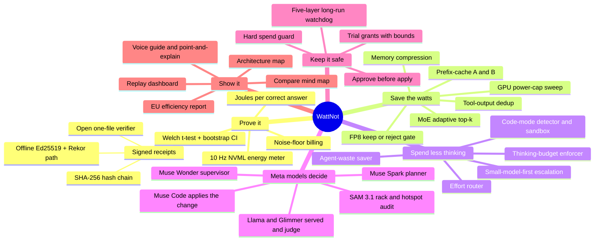
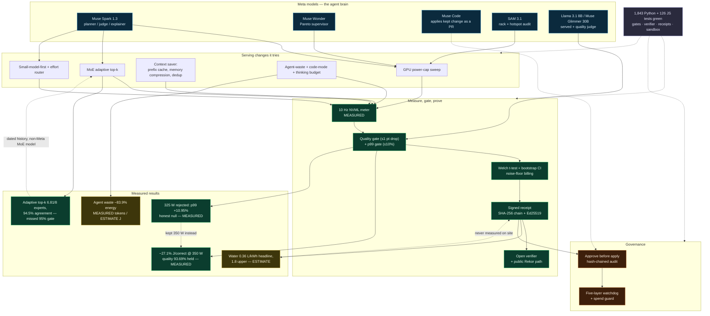

# WattNot — the journey

This page is the map of how WattNot was built during the Meta Global AI Developer
Hackathon (Oct 26 – Nov 4 2026): the innovations, the features, the measured results,
the decisions that shaped them, and the tests that hold them in place. Before Oct 26
there was only planning docs and no code.

WattNot is an agent that cuts the energy and cost of each LLM inference request without
making the model worse. It tries serving changes (batching, KV-cache settings, FP8, GPU
power caps, MoE expert pruning), keeps a change only if quality and p99 latency hold, and
writes a signed receipt (Wh and $ per request) anyone can re-check with the open verifier.

**Every number carries one honest label:**

| Label | Meaning |
|---|---|
| **MEASURED** | Read from a meter or an API log (NVML energy counter, billed tokens, recorded unit counts). |
| **ESTIMATE** | Derived from a measured number and a stated assumption (water from energy; cost from a tariff; energy scaled from a published J/token rate). |
| **SIMULATED** | Produced by a software model, not hardware (the flex power model, painted thermal frames). |
| **MOCK** | A dry-run fixture (fake meter, fake planner) used to rehearse the pipeline. |
| **REPLAY** | A saved run re-evaluated; nothing runs live. |
| **ADVICE** | A recommendation or risk note, not a measurement. |

Headline result: **−27.1% joules per correct answer** at a 350 W cap on one H100,
pass rate unchanged at 93.69% on 666 checked answers — MEASURED, signed, and replayable
at <https://ak9381.github.io/wattnot/>.

---

## 1. The journey as a mind map



---

## 2. The knowledge graph

How the pieces connect: Meta models drive the agent, the agent proposes serving changes,
the meter and gates decide what to keep, a signed receipt records it, and tests hold every
link in place. Dashed edges are honest caveats.



---

## 3. The cutting-edge work

What makes WattNot more than a token counter — the parts that are genuinely novel.

- **Joules per correct answer as the unit.** Not tokens, not raw watts: energy divided by
  answers that pass a fixed check. A change that saves power but loses answers does not win.
- **Signed, re-checkable receipts.** Every saving is a small JSON file with a SHA-256 hash
  chain, an offline Ed25519 signature, and a path to the public Rekor transparency log. It
  carries numbers, model ids and settings only — never prompts or outputs. A one-file
  verifier (stdlib only) re-checks it in a browser; the demo ships 3 real and 3 forged
  receipts so a sceptic can watch a forgery fail.
- **Noise-floor billing.** A saving is only billed if a Welch t-test clears p < 0.05 and a
  10,000-sample bootstrap CI stays above zero. Looks-good-but-noise never counts.
- **MoE adaptive top-k.** Routes each token to the fewest experts whose weights cover a
  mass threshold, skipping the rest — and gates on teacher-forced token agreement so quality
  is defended, not assumed.
- **Agent-waste saver.** Detects repeated calls, no-ops, short cycles, and reasoning
  overshoot in agent loops, adds a clean `done` exit, and a second layer catches sub-agent
  sprawl.
- **Code-mode detector + locked-down sandbox.** Spots runs with many round trips and a big
  tool list, models the saving if the tools were a code API instead, and can replay the
  collapsed task in a no-network, CPU/memory-capped, write-jailed sandbox to measure it.
- **SAM 3.1 physical audit.** Counts the servers actually visible in a rack photo, reconciles
  against inventory, and refuses to touch a GPU it cannot see — a vision model feeding a power
  decision.
- **Approve-before-apply governance.** WattNot never changes a cap, a vLLM setting, a routing
  policy or a flex shed by itself; it files a proposal with the saving, the gates and a receipt
  preview, and a person approves it. On an unattended run (the H100 test) the approval comes
  from a policy a named operator set beforehand: the change still shows as pending, is approved
  only if the policy's thresholds hold, and the receipt says "approved by policy, set by
  operator <who> at <when>". Every step is hash-chained.
- **Five-layer long-run watchdog.** Three on-box layers plus two off-box (a cron job and a
  laptop daemon) read the same heartbeat and run the same idempotent teardown, so a dead
  control box can still be torn down.

---

## 4. Measured results

All MEASURED on one NVIDIA H100 80GB (Llama 3.1 8B Instruct on vLLM), 666 checked answers,
3 reps per arm, interleaved stock blocks for the noise floor.

### Power-cap sweep (RUN2)

| Setup | J / correct (mean ± sd) | vs default | p99 | Gate |
|---|---|---|---|---|
| Default vLLM (no cap, 700 W) | 17.03 ± 0.14 | +0.0% | +0.0% | baseline |
| Power cap 500 W | 16.38 ± 0.01 | −3.8% | +0.7% | passed |
| Power cap 450 W | 14.69 ± 0.81 | −13.7% | +1.8% | passed |
| Power cap 400 W | 13.81 ± 0.01 | −18.9% | +4.7% | passed |
| **Power cap 350 W** | **12.42 ± 0.00** | **−27.1%** | **+7.7%** | **passed (kept)** |
| Power cap 325 W | 11.84 ± 0.01 | −30.5% | +10.9% | failed: p99 > 10% limit |

The saving is signed: Welch t = 57.2, p = 0.00015; bootstrap 95% CI [26.7%, 27.8%];
billed at the CI lower bound, 26.7%. The 325 W result is a published **honest null** — more
energy saving, but it broke the latency contract, so it was rejected.

### Other measured results

| Result | Number | Label |
|---|---|---|
| Agent-waste saver (loop-on vs unoptimized) | −83.9% energy, −83.4% wall-time, −80.7% spend | MEASURED tokens / ESTIMATE energy |
| Adaptive top-k, mass 0.95 | 6.81 of 8 experts active, 94.5% token agreement (missed the 95% gate), −6.6% J/token, −12.3% p99 | MEASURED |
| Stock-block noise | cut from 8.6% to 0.6% sd/mean after warm-up and burn-in fixes | MEASURED |
| Water per request | **0.36 L/kWh** on-site cooling headline; up to **1.8 L/kWh** including power-plant water | ESTIMATE |
| Fleet impact | Wh delta scaled to a monthly figure at a stated tariff/PUE | ESTIMATE (only the Wh delta is MEASURED) |
| Flex grid shed | sheds to the limit p99 and quality allow | SIMULATED (software power model) |

The adaptive top-k agreement figure was measured on a non-Meta MoE model and is kept only as
dated history; the H100 run and headline use Meta models (Llama, Glimmer).

---

## 5. Key decisions

Choices that shaped the build, stated plainly.

- **Joules per correct answer is the headline**, so a power saving can never hide a quality
  loss.
- **Two separate quality bars, by lever.** Power caps must hold the fixed-check pass rate
  within 1 point; adaptive top-k and routing use a 95% token/answer agreement gate. They are
  not the same test and the receipt says so.
- **RUN2 quality is judged by deterministic fixed checks** (string and number matching, no
  model as a judge). Results with the hosted Meta judge (with a Llama fallback) are reported
  separately when measured.
- **Publish the null.** 325 W saved the most energy but failed the p99 gate, so it was
  rejected and shown rejected.
- **Approve before apply.** No change lands without a person, and every step is auditable.
- **Meta models on the serving path**, with earlier non-Meta benchmarks kept only as dated,
  labelled history.
- **A mock certificate, never a carbon credit.** The one-page certificate is watermarked
  MOCK / NOT TRADABLE; no neutrality or offset is claimed.
- **Water is always an ESTIMATE**, with a conservative on-site headline (0.36 L/kWh) and a
  clearly separate upper bound (1.8 L/kWh). It is never measured on site.
- **Not a chat UI.** The demo opens on who benefits and the saving, then a verifier forge
  challenge, a live-run canvas and a Pareto with error bars.

---

## 6. Tests

The pipeline is held in place by a large automated suite — green at the pre-launch review:
**1,843 Python tests passed (5 skipped)** and **126 JS tests passed**.

| Area | What is tested |
|---|---|
| Gates | Fixed answer checks, p99 ceilings, Welch + bootstrap noise floor |
| Receipts & verify | SHA-256 chain, JCS canonicalization, grading, the standalone one-file verifier, forged-receipt rejection |
| Power & trials | NVML cap/clock control, trial grants, energy budgets, idempotent restore |
| Planners | Muse Spark proposals, open-weights planner fallback, Optuna warm start, Pareto knee |
| Agent waste & sandbox | Loop/no-op/cycle/reasoning detectors, the no-network write-jailed sandbox |
| Approvals | Proposal state machine, risk classification, rollback on reject/timeout |
| SAM & room | Box dedup, unit reconciliation, per-node ceiling, hotspot derate |
| Cloud & hosted | Effort router, meter audit, spend guard, three-placement compare |
| Watchdog & SSH | Heartbeat publishing, off-box teardown, bounded SSH reconnect |
| Frontend | Event-stream rendering, a11y labels, contrast, fallback to replay |

Run them with no GPU and no network:

```bash
python -m pytest -q
node tests/js/index.js
```

---

## 7. See it yourself

- **Replay (nothing runs live):** <https://ak9381.github.io/wattnot/> — open the **Proof** tab.
- **Verify a receipt:**

  ```bash
  pip install -e .
  wattnot verify --chain verifier/samples/chain/
  python verifier/wattnot_verify.py --chain verifier/samples/chain/   # stdlib only
  ```

- **Rebuild a report, no GPU:** `python -m wattnot.proof.run report --out results/proof`
- **More depth:** [README](../README.md), the module PRDs/TDDs in `docs/modules/`, the receipt
  spec in [SPEC.md](../SPEC.md), and the method for joules per correct answer in
  [docs/joules-per-correct-answer.md](joules-per-correct-answer.md).
