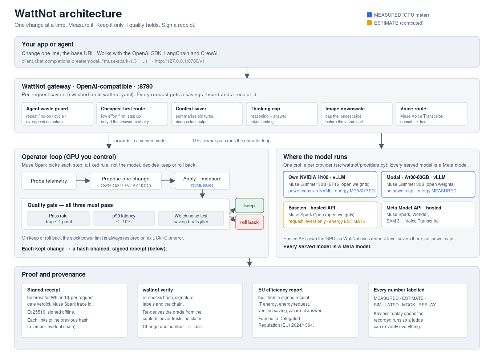

# WattNot — Design

Author: Akash K Raju (GitHub [ak9381](https://github.com/ak9381)) · Indie track · Push the Frontier (energy)
Built during the Meta Global AI Developer Hackathon, Oct 26 – Nov 4, 2026.

This document describes the real design of WattNot: what it is, how it is put together, how data
flows through it, and where every number comes from. File paths point at the code that implements
each part. Every figure is labelled MEASURED, ESTIMATE, SIMULATED, MOCK or REPLAY.

---

## 1. Goals

Serving an LLM burns power and water in the data center. Token trimmers cut the bill by sending
fewer tokens; they do not change how many joules each token costs on the GPU. WattNot targets the
joules.

1. **Cut the energy of each inference request** by changing how the model is served.
2. **Never degrade answers.** A change is kept only if a fixed quality gate passes.
3. **Prove it.** Every kept change is a signed, hash-chained receipt anyone can re-verify.
4. **Report it.** Turn a receipt into a one-click EU energy-efficiency report.

Advisory by default: WattNot proposes a change, shows the saving and the checks, and a person
approves before anything is applied (`src/wattnot/approvals/`).

---

## 2. Architecture overview

Two entry points share one core:

- **Gateway** — an OpenAI-compatible proxy (`wattnot gateway`, `src/wattnot/gateway/build.py`) that
  sits in front of your app on `http://127.0.0.1:8780/v1`. It applies per-request savers and writes a
  savings record and a receipt id for each request.
- **Operator loop** — on a GPU you control (`src/wattnot/control/controller.py`), it tries one
  serving change at a time, measures the joules, runs the quality gate, and keeps or rolls back.

Both write the same labelled events and the same receipt format, so the dashboard, the verifier and
the EU report read either one.

---

## 3. Components

| Component | Package | What it does |
|---|---|---|
| Control loop | `control/controller.py` | Steps a power cap down one level at a time; keeps the best cap that passes the gate |
| Power-cap controller | `control/nvml_ctl.py` | Caps the GPU through NVML (ctypes); always restores the stock limit |
| Quality gate | `gates/` | Pass rate, p99 latency and Welch noise checks; a fixed rule decides |
| Savers | `route/`, `agentwaste/`, `context_saver/`, `longrun/` | Request-level and serving-level energy savers |
| Gateway | `gateway/` | OpenAI-compatible proxy; applies savers per request; savings log |
| Providers | `providers.py` | Four profiles (h100, modal, baseten, combined) and what each may touch |
| Meter | `meter/attribution.py` | Splits window energy into per-request joules by token share |
| Receipts | `receipt/`, `verify.py`, `verifier/` | Builds, signs (Ed25519) and verifies hash-chained receipts |
| EU report | `report/eu.py` | Exports a Delegated Regulation (EU) 2024/1364-framed report |
| Spend guard | `spend/guard.py` | Hard/soft spend caps per provider; refuses a call that would pass the cap |
| Approvals | `approvals/` | Proposal → approve → apply, with rollback and an audit trail |
| Meta clients | `meta/`, `spark_open/`, `sam/`, `spokenanswer/`, `vision/`, `musecode/` | The Meta model calls |
| Dashboard | `web/dash/`, `src/wattnot/dash/` | Replays, Proof, EU report, Meta tools; default run `plugin-h100-1104` |

---

## 4. Data flow

**Gateway request path** (`gateway/build.py`):

1. Your app calls the gateway with an OpenAI-shaped request.
2. The **agent-waste guard** checks for repeat / no-op / cycle / overspend before anything is sent.
3. **Cheapest-first routing** picks the lowest reasoning effort first and steps up only if the answer
   looks shaky (`route/`).
4. The **context saver** trims long chats (summarise old turns with Muse Spark, dedupe tool output),
   gated so the pass rate cannot drop more than a point (`context_saver/middleware.py`).
5. The **thinking cap** bounds reasoning + answer tokens; **image downscale** caps the longest side;
   the **voice route** sends audio to Muse Voice Transcribe.
6. The request is forwarded to the upstream model. A **savings record** and a **receipt id** are
   written to `out/gateway/savings.jsonl`.
7. A 10% shadow sample re-asks the baseline tier off the request path and rolls routing back if
   answers stop agreeing (`/v1/wattnot/monitor`).

**Operator loop (GPU you control)** (`control/controller.py:36`):

1. **Probe** telemetry and run a preflight.
2. **Propose** one change (a lower power cap, or a serving change such as FP8 or KV-cache mode).
3. **Apply and measure**: set the cap through NVML, run the fixed prompt tiers, read the joules from
   the NVML energy counter (MEASURED).
4. **Gate**: pass rate, p99 and the Welch noise test.
5. **Keep or roll back**: on pass, record the step and emit `action.applied`; on fail, revert to the
   best cap and emit `action.rolled_back` with the failed gate names, then stop stepping down.
6. **Sign** a receipt for the kept change.

---

## 5. Quality gate

All three checks must pass (`gates/decide.py`). The model can explain a verdict; it never overrides
the rule.

- **Pass rate** (`gates/fixed.py`): the candidate pass rate must be within `max_drop_pts` of the
  baseline. Default 1.0 point. Answers are graded by fixed checks — deterministic number matching for
  GSM8K, the item's own unit tests for HumanEval — not by a model judge.
- **p99 latency** (`gates/latency.py`): candidate p99 must be within `baseline_p99 × (1 + slack)`.
  Default slack 10% (`settings.max_p99_increase()`), overridable with an explicit SLA.
- **Welch noise test** (`gates/noise.py`): a one-sided Welch t-test plus a bootstrap 95% CI on the
  per-repetition Wh/request. A saving counts as billable only when `p < alpha` (default 0.05) **and**
  the CI lower bound is above zero. Otherwise the result is graded NOISE.

---

## 6. Rollback and safety

- The power-cap controller saves the stock limit on entry and restores it on normal exit, on error,
  and on SIGTERM/SIGHUP (`control/nvml_ctl.py`). The `./start.sh gpu` launcher and the harness both
  restore it, so a hard kill still leaves a documented `nvidia-smi -pl` recovery line.
- Writes are clamped to the driver's min/max and to an optional rack/facility ceiling
  (`tighten_max`); a restore bypasses the ceiling so it can never get stuck low.
- Nothing is applied without approval by default (`approvals/`). The unattended H100 script requires
  an explicit `--pre-approved` flag.
- Spend is bounded per provider by the spend guard (`spend/guard.py`): it reserves the worst case
  before every call and refuses anything that would pass the hard cap minus a billing-lag margin.

---

## 7. Savers

| Saver | File | What it does |
|---|---|---|
| Power cap | `control/controller.py`, `control/nvml_ctl.py` | Steps the GPU power limit down; measures joules per tier; gates quality and p99 |
| FP8 quantization | `longrun/harness.py` (MODELS), `scripts/glimmer_serve.sh` | Serves the model in FP8 as a candidate; kept only if the gate passes (it was refused on the H100 — see §12) |
| KV-cache mode | measured as a lever on the H100 | A/B of the KV-cache dtype; refused when p99 blew out (see §12) |
| Batching | `longrun/harness.py` | Token budget and concurrency set per tier |
| Prefix caching | `context_saver/prefix_cache.py` | A/B on vLLM prefix caching; measures hit rate, energy and p99 |
| Thinking / reasoning budget | `longrun/thinking_budget.py` | Caps reasoning effort and max tokens per request |
| Context saver | `context_saver/middleware.py` | Summarises old turns (Muse Spark live; offline mock under `WATTNOT_META_MOCK=1`), keeps a chunk store, dedupes tool output |
| Cheapest-first routing | `route/router.py`, `route/escalate.py` | Low effort first, step up only when the answer is shaky, count the retry's cost |
| Agent-waste proxy | `agentwaste/proxy.py`, `agentwaste/detect.py` | Repeat / no-op / cycle / reasoning-storm / overspend detectors on agent loops |
| LangChain drop-in | gateway (`gateway/`) | The same savers behind a one-line base-URL change in LangChain / CrewAI / the OpenAI SDK |

Every saver is measured against the stock run on the same prompts and seed; only the one setting
changes.

---

## 8. Energy attribution

`meter/attribution.py` splits a measured energy window into per-request joules. Each request is
allocated energy in proportion to its token count, with a per-request cap (default 0.5 of the window)
so one long request cannot absorb the whole window; the remainder is re-allocated until no request
exceeds the cap. If the window reads zero, the split is even. This follows the token-share method
Neuralwatt describes; the window energy itself is read from NVML (MEASURED) on a GPU we control, or
estimated from tokens on a hosted API (ESTIMATE).

---

## 9. Receipts, signing and verify

**Build** (`receipt/build.py`). A receipt records the before/after Wh and `$` per request, the gate
verdict, the per-repetition samples, the Welch result, and the Muse Spark trace id. It carries an SCI
(carbon) block and a joules-per-correct-answer block
(`j_per_good_answer = wh_per_req × 3600 / pass_rate`).

**Sign** (`receipt/sign.py`). The receipt is canonicalised (JCS), hashed (SHA-256 over everything
except the `integrity` block), and signed offline with an Ed25519 key. An optional keyless Sigstore
path (GitHub OIDC) uploads to the public Rekor log when explicitly approved.

**Chain.** Each receipt's `integrity.prev_sha256` equals the previous receipt's `integrity.sha256`,
so a run is a tamper-evident chain (`verify.py`).

**Verify** (`verify.py`, and the stdlib-only `verifier/wattnot_verify.py`). `wattnot verify` checks:

1. the schema and spec (`wattnot.receipt/1`);
2. the canonical SHA-256 hash;
3. the Ed25519 signature (and, with `--rekor-online`, the Rekor entry);
4. that every `label` is a known enum;
5. the **grade, re-derived from the content** (VALID / ESTIMATE / SIMULATED / NOISE / UNVERIFIABLE) —
   never trusting the grade the receipt claims;
6. the hash chain (with `--chain`).

Change one number and the hash no longer matches, so verification fails. A receipt's grade is never
upgraded on re-verifying; it can only be downgraded.

---

## 10. EU efficiency report

`report/eu.py` reads a signed receipt and writes a CSV and an HTML report framed to Delegated
Regulation (EU) 2024/1364. It reports IT energy over the measured window, energy per request (and the
baseline), the verified energy saving (the Welch CI lower bound, MEASURED or ESTIMATE), idle power if
measured (else NOT_AVAILABLE), and joules per correct answer. The Plugin and Modal replays ship a
generated `eu_report.html`; the Baseten replay's report is the page the hosted round wrote, because a
hosted API has no GPU meter.

---

## 11. Providers and Meta models

Four profiles, one table and one entry point (`providers.py`,
`python scripts/e2e/round.py --provider …`):

| Profile | Where | Served model | Power cap | Energy | Levers |
|---|---|---|---|---|---|
| **h100** | Our rented E2E Networks H100 80GB VM, vLLM | Muse Glimmer 30B (BF16) | yes (NVML) | MEASURED | every lever |
| **modal** | Modal A100-80GB, vLLM | Muse Glimmer 30B | no (Modal refuses the NVML write) | MEASURED | all but power cap |
| **baseten** | Baseten hosted API | Muse Spark Open | no (no GPU access) | ESTIMATE (tokens → joules) | request levers only |
| **combined** | all three on the same prompts | — | — | mixed | routes per class by pass rate, then lowest $/correct |

**Meta models and their roles** (every runtime model is a Meta model; no Llama model is used):

- **Muse Spark** (`muse-spark-1.3`, Meta API) — the operator: picks the next change, grades answers
  for the gate, explains a verdict; also the context-saver summariser and the voice-guide intent step.
- **Muse Spark Open** (`meta-models/muse-spark-open-1026`, open weights, Baseten) — the hosted-API
  round and a cap-sweep planner arm.
- **Muse Glimmer 30B** (`meta-models/Muse-Glimmer-30B`, open weights) — the served model tuned on the
  H100 and on Modal; also reads the vision test images.
- **Muse Wonder** (`muse-wonder-1.0`, Meta API) — plans the next cap/clock and reads the Pareto chart.
- **Muse Voice Transcribe** (`muse-voice-transcribe-1.0`, Meta API) — spoken Ask and the dashboard mic.
- **SAM 3.1** (`sam-3.1`, Meta API) — rack hotspot audit on a room scan (a cross-check).
- **Muse Code** — opened the power-cap tuning PR from a run result (replayed in demos).

Synthetic test images were pre-generated with **Muse Image** and labelled SYNTHETIC; no run makes a
live Muse Image call, so it is not a runtime model.

Why open weights: power caps, batching, KV-cache settings and quantization can only be changed on a
server you control. A closed API cannot be power-capped or retuned, so the model whose watts WattNot
measures has to be open-weights on our own GPU.

---

## 12. Labels policy

Every number carries a label, and the dashboard keeps SIMULATED/MOCK content hidden until you flip
the "Illustrations" switch.

- **MEASURED** — read from the GPU meter (NVML), the billing ledger, or real wall time.
- **ESTIMATE** — computed from assumptions (tokens → joules, tariff, water factor).
- **SIMULATED / MOCK** — a software model or placeholder (the fake GPU + oracle model in dry runs).
- **REPLAY** — a recorded real event replayed, not re-run.
- **ADVICE** — a recommendation, not a measurement.

The verifier re-derives the grade from the content, so a receipt cannot claim a stronger label than
its data supports (`receipt/grade.py`).

---

## 13. Measured results

All MEASURED on Muse Glimmer 30B unless noted. Proof files are linked from the README's Results table.

- **Plugin run, H100 (Nov 4):** live gateway traffic, 375 W vs stock 700 W. **−12.9% joules per
  correct answer** (1249.4 → 1088.5), quality held at 54/60 in both arms, Welch p = 0.027.
  (`receipts/h100-1104/rcpt_20261104-000651-text.json`)
- **Sealed GSM8K holdout, H100 (Nov 3):** frozen full stack (375 W + low effort) vs stock.
  **−26.65% joules per request** (233.4 → 171.2), quality 92.0% in both arms (899/977), McNemar
  p = 1.00, run once on prompts the system never saw.
  (`data/h100-holdout-1103/holdout_result.json`)
- **FP8 refused, H100 (Nov 4):** FP8 cut energy 42.5% but matched only 15 of 16 answers, so the gate
  refused it and rolled back to BF16. KV-cache mode saved 1.4% but pushed p99 +43.6%, also refused.
  (`replays/h100-max-1103/lever-takes-1104.json`)
- **Power-cap sweep, H100 (RUN2, early 8B comparison model, not a Meta model, not a headline):** 350 W passed at −27.1% J/correct; 325 W rolled back for p99
  +10.9% (limit 10%).
- **Modal A100, r05:** −77.0% J/correct (2954.6 → 678.4), accuracy 96% → 97% (MEASURED, NVML).
  (`replays/modal-r2/receipt.json`)
- **Baseten, Spark Open, r02:** 719.3 → 482.5 J/correct (ESTIMATE, no GPU meter), accuracy 98% → 98%.
  (`replays/baseten-r1/receipt.json`)

---

## 14. Limits

- Hosted-API energy (Baseten) is a token-based ESTIMATE; there is no GPU meter on a hosted API.
- Modal cannot cap power (the platform owns the GPU); energy is still MEASURED from NVML.
- Water and cost are ESTIMATE (0.36–1.8 L/kWh; tariff 0.12 USD/kWh); only the Wh delta is measured.
- Flex mode (grid events), mock certificates and the router region what-if are SIMULATED/MOCK until a
  live run records them.
- The Baseten demo key expires Nov 9, so live Baseten calls stop after that; the replays still work.

---

## 15. Roadmap (coming)

- A one-command `curl … | bash` installer (`start-here/install.sh`).
- A shared demo key for Meta API and Modal behind a capped server-side proxy, with an optional
  own-key field, so judges can make live calls without their own account.
- A CSRD report pack as a paid add-on on top of the EU efficiency report.
- A user-set context-saver threshold and a recommendations layer (what to change next).
- A real carbon/water certificate (today it is a MOCK).
